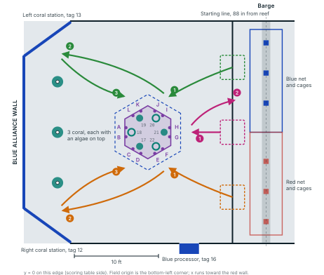

import AutoReplay from '../../../components/AutoReplay.astro';

:::note[Draft]
First draft, written from the code and its notes as of November 23. Nothing here has run on a real robot yet.
:::

The reef has twelve nearly identical places to score, and a cycle is only about 8 seconds long. Most of the points come from taking the lining-up away from the driver. The same code that lines up in teleop also runs the autos.

## What we decided

- **The robot finishes each approach itself.** The driver holds a trigger. The robot drives to the branch, raises the elevator and scores.
- **No drawn paths.** Every move is "drive straight to this spot", in teleop and in auto.
- **One camera.** Near the reef, one AprilTag and the gyro are enough to fix the robot's position.
- **Autos are built from teleop's parts,** and picked from a list on the dashboard.

## Knowing where the robot is

- **Odometry.** The wheels and the gyro track the robot's position 250 times a second. It drifts slowly.
- **The position fix.** Near the reef, the camera sees the tag on the face being scored on. From that one tag and the gyro heading, the code works out where the robot is and corrects the odometry.
- **Its limit.** The camera faces forward, so there is no fix at the coral station.

Each reef face has a tag between its two branches. The scoring spots are worked out from the tag: 17.25 in out from the face, and 6.47 in left or right for the branch.

## Driving to a spot

The robot drives in a straight line to the target. Its speed depends on how far it has left to go, so it slows as it arrives. A move that would cross the reef goes round it, through a point on a circle 2 m from the reef centre.

**Tall robots tip.** The code limits how hard the robot can accelerate to 80% of the tipping limit at the carriage's present height: about 8.4 m/s² stowed and about 4 m/s² at full height. The tipping limits are worked out on the [elevator page](../../subsystems/elevator/).

## The controls

One Xbox controller runs the whole robot.

| Control | Action |
| --- | --- |
| Left stick | Drive, field-relative |
| Right stick | Turn |
| Y, X, B, A | Pick L4, L3, L2 or L1 for the next score |
| Right trigger, held | Drive to the right-hand branch of the nearest reef face, raise and score |
| Left trigger, held | The same for the left-hand branch |
| Right bumper, held | Pick up at the nearest coral station |
| Left bumper, held | Take the algae off the nearest reef face |
| D-pad up | Score the algae in the net |
| D-pad down | Score the algae in the processor |
| D-pad right, held | Climb |
| D-pad left, held | Let an empty fork back down |
| Back | Stow and cancel |
| Start | Reset the heading |

Letting go of a trigger or bumper cancels the move.

## The autos

*Branches are lettered A to L. The orange, green and pink paths are the right, left and centre routines.*

| Name on the dashboard | Starts | What it does |
| --- | --- | --- |
| Idle | Anywhere | Nothing. This is the default |
| Leave | Anywhere | Drives off the starting line |
| 1 Right | Right | Preload on E at L4 |
| 1 Centre | Centre | Preload on H at L4 |
| 1 Left | Left | Preload on J at L4 |
| 3 Right: E, C, D | Right | Preload on E, then two station cycles onto C and D, all at L4 |
| 3 Left: J, L, K | Left | The mirror image: J, then L and K |
| Centre: H and algae | Centre | Preload on H at L4, take that face's algae and score it in the net |

In simulation, every auto scores exactly the branches it lists, on both alliances, inside 15 seconds.

### Watch one run

These are recordings of the code driving the simulated robot, ten samples a second: every blue auto, and one deep climb. The robot drives the recorded path on a 3D field, moving its elevator, wrist and claw as they moved in the run, and the coral it scores stay on the reef. The map under it shows the whole path at once. Press Play, or drag the slider to step through. Drag the 3D view to look round, or switch it to the whole field.

The field is built from the field drawings as simple shapes, so it is the right size and in the right place but not as detailed as the real one. The climb has no path, so it shows the robot alone.

<AutoReplay />

In the three-coral routines a station cycle takes about 5.6 s, of which 0.7 s is the wait for the human player. That leaves about 1.3 s spare out of the 15.

### How an auto is built

- **Legs.** An auto is a chain of legs. A scoring leg ends when the coral sensor sees the coral leave. A station leg ends when the sensor sees a coral arrive.
- **Timeouts.** Every leg has one, so a late coral costs one piece and not the whole routine.
- **Start position.** Every auto declares where it starts. A dashboard button sets the robot's position to that spot, and a warning shows until it has been pressed.
- **Red and blue.** The field is the same turned half a turn, not mirrored. A red auto is the blue one rotated 180° about the centre of the field.
- **A boring one for every start.** The one-coral autos are simple on purpose. The Auto RP depends on the least reliable robot on the alliance.

## What the robot still has to prove

- The camera fix is used without correcting for delay. At 3 m/s that is an error of about 7 cm.
- A score ends about a quarter of a second after the coral sensor clears. Check on the robot that the coral really is clear by then.
- Speeds, gains and current limits are starting values from simulation.

## Your turn

To add an auto to this code:

- [ ] Add its name to the list in `autos/Auto.java`.
- [ ] Write its routine in `autos/AutoFactory.java` from the existing legs, with its start position and the branches it should score on.
- [ ] Add one row to the chooser table with the name the dashboard should show.
- [ ] Run the auto tests. The new auto runs on both alliances. It must score exactly the branches it lists, inside 15 seconds, without breaking a keep-out rule.

For a new game:

- [ ] Find what the driver spends time lining up, and let the robot do it.
- [ ] Build autos from the same moves the driver uses.
- [ ] Make every auto declare its start position, and make a wrong start impossible to miss.
