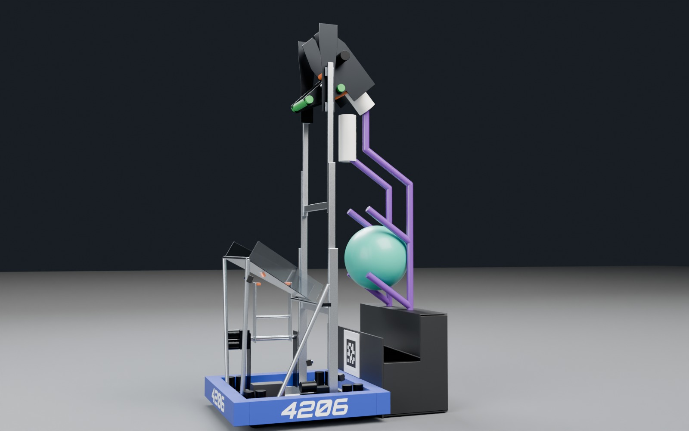
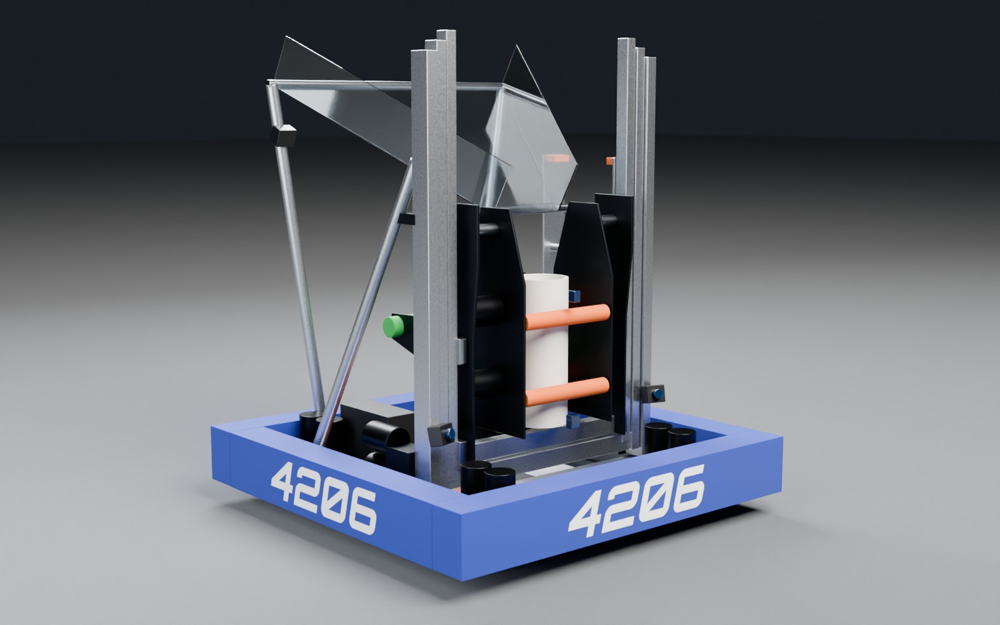
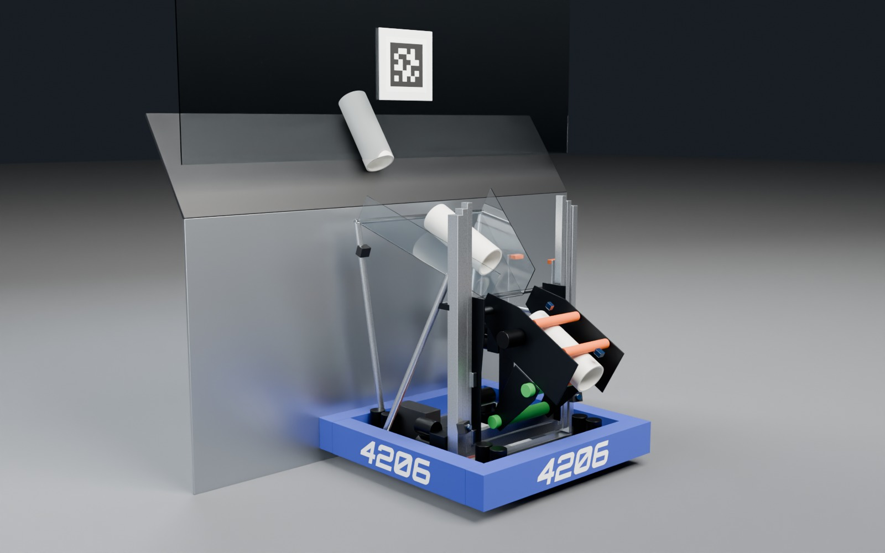
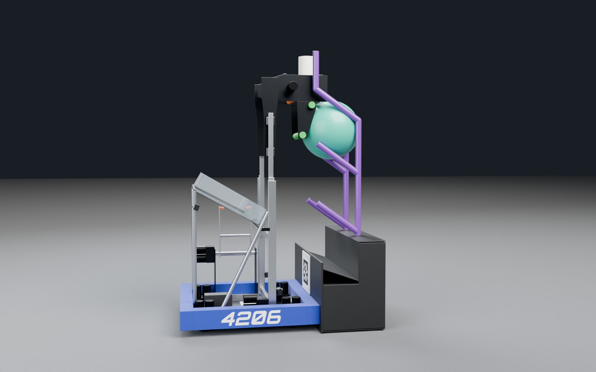
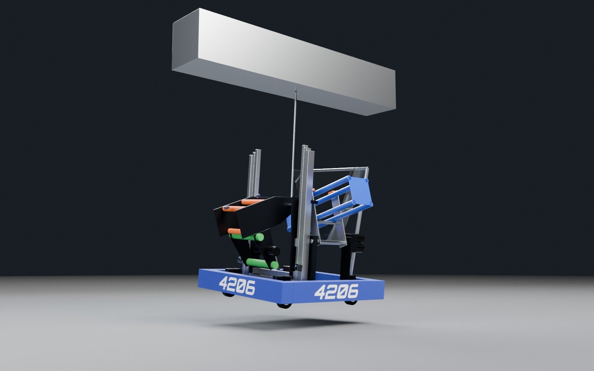

import Calc from '../../components/Calc.astro';
import ConceptViewer from '../../components/ConceptViewer.astro';

:::note[Draft]
First draft, written from the kickoff analysis. Everything on this page is the concept as it stood before any detailed design.
:::

A concept is the whole robot worked out roughly: what the big pieces are, how a game piece moves through them, and whether it fits the rules. It comes before any detailed design, and it should cover every must on [the priority list](../choose-what-to-be-good-at/).

This chapter has two steps. First decide what kind of robot it is. Then work that out far enough to move it around on a screen and check it against the field.

## Step 1: decide what kind of robot it is

Start from the priority list and ask what each job takes. If one layout covers every must, that is the robot.

| Job | What it takes | The piece that does it |
| --- | --- | --- |
| Drive well and never break down | A fast, low, tough base | Swerve drivebase |
| Score on L4 from the station | Take a coral in at the back, lift it 72 in, let it go at the front | Funnel, three-stage elevator, pass-through wrist |
| Climb the deep cage | Grab the cage and lift the whole robot | Climber |
| Score a coral in auto | Start the match holding a coral, and know where the reef is | The wrist stows a preload. Cameras read the reef tags |
| Pull algae off the reef | Grip a ball at two heights | Algae claw under the wrist |
| Score on L2 and L3 | The same wrist, lower down | Elevator and wrist |

One layout covers every must and every should: an elevator on a swerve base, with a wrist that coral passes straight through. Of the two coulds, the claw also reaches the net. Floor pickup was left out.

**An option we did not take:** a separate arm for algae. A claw under the wrist reuses the elevator that is already there.

## Step 2: work the concept out

### What it is

A continuous elevator on a 28 in swerve frame, with a wrist that coral passes straight through. Coral drops into a funnel at the back and leaves from the front, so the robot runs between station and reef without turning its mechanism around. An algae claw hangs under the wrist, and a fork on the left rail takes the deep cage.

### Move it yourself

Pick a pose to see the robot at each job. Show one subsystem at a time, pull the subsystems apart, or turn on the rule envelopes to see the size limits.

<ConceptViewer title="Interactive 3D model of the concept robot" />

With rule envelopes on, the amber box is the 28 in frame carried up to the 42 in starting height, and the red box is the 18 in reach limit.

This is concept geometry: plates, tubes and rollers at the right sizes and positions, without fasteners, belts or wiring.

### The same robot, rendered

*Scoring on L4. The algae lower on this face is still in place and is not in the way.*

*Starting configuration: 39.7 in tall, with the first coral stowed between the elevator rails.*

*Station pickup. Coral drops into the funnel and slides through the elevator into the wrist.*

*Pulling a high algae off the reef with the claw under the wrist.*

*Deep cage. The fork has rotated the cage across the robot and the wheels are off the carpet.*

### Each piece, and why it is that way

| Piece | The concept | Why |
| --- | --- | --- |
| Swerve drivebase | 28 × 28 in frame, 34.5 in across the bumpers, geared for about 15 ft/s | A reef face is 37.8 in wide and the cages hang 42.9 in apart, so a 34.5 in robot fits beside a partner at both |
| Three-stage elevator | Wrist pivot runs from 24.5 to 90 in. Two motors, under 1 s for full travel | The carriage moves first. The station, L2, the processor and the low algae are all inside its first 22 in |
| Pass-through wrist | Four rollers grip the pipe along its length. It pivots on two stub axles | Stub axles leave the middle open, so coral enters from behind and leaves from the front |
| Algae claw | Two 12 in rollers under the wrist | Under, not over: a claw on top would hit the next branch up when scoring L2 and L3. Holding the ball below the coral path lets the robot carry one of each |
| Station funnel | A polycarbonate tray 25 in wide at the top, narrowing to 7 in on a 30° slope | Its top edge sits 1.75 in under the station opening, and it narrows to guide the coral into the wrist |
| Deep-cage climber | A fork on the left rail. Strafe into the cage, latch it, rotate 108° | The cage ends up across the robot with the chain over the centre of gravity. A ratchet holds it after the match ends |
| Vision and sensors | Two cameras aimed at the reef tags, one high at the back for the station | The reef tags are only 12.1 in off the carpet. Sensors in the wrist stop a coral in the same place every time |

### Does it fit the rules and the field?

| Check | Limit | Concept |
| --- | --- | --- |
| Frame perimeter | 120 in at most | 112 in |
| Starting height | 42 in at most | 39.7 in |
| Reach past the frame | 18 in at most | 12 in, with the fork out |
| Weight | 115 lb at most | 106 lb, estimated |
| Drive motors | 4 at most | 4 |
| L4 branch tip | 72 in up | Wrist pivot reaches 90 in |
| Station opening | 37.5 in up | Funnel edge at 35.75 in |
| Processor opening | 7 to 27 in up | Ball held between 8.5 and 24.7 in |

<Calc id="frame-fit" />

### Weight, estimated

| Subsystem | Weight | Motors |
| --- | --- | --- |
| Drivebase and electronics | 52 lb | 8 |
| Elevator | 19 lb | 2 |
| Wrist and algae claw | 11 lb | 3 |
| Funnel | 5 lb | 1 servo |
| Climber | 13 lb | 2 and a servo |
| Cameras, wiring, fasteners | 6 lb | |
| **Total** | **106 lb** | **15** |

These are estimates made before any CAD. [From concept to final design](../subsystems/from-concept-to-design/) shows how they held up.

### What to prototype first

A concept is full of guesses. Test the biggest ones first, with the cheapest thing that will answer the question.

1. **Funnel.** Does a coral dropped any way round turn end-on before it reaches the rollers? This is the largest unknown, and a sheet of polycarbonate answers it.
2. **L4 release.** Find the wrist angle and roller speed that place a coral on the top branch every time.
3. **Algae grip.** Roller spacing and squeeze that hold a 16.25 in ball through a hard stop.
4. **Cage latch and lift.** About 150 lb acting 13 in from the pivot is roughly 2,000 lb·in. Prove the fork, the gear ratio and the ratchet on a hanging cage.
5. **Tall and moving.** At the net the robot is about 106 in tall. Measure how hard it can accelerate with the elevator up before it tips.

## Your turn

- [ ] For each job on your list, write what it takes and which piece does it.
- [ ] Look for one layout that covers every must. Write down the options you did not take, and why.
- [ ] Sketch how a game piece gets in, where it is held and how it gets out.
- [ ] Check the concept against every size, weight and reach limit, and against the field.
- [ ] Estimate the weight, with a line for wiring and fasteners.
- [ ] List what you are guessing, and prototype the biggest guess first.
