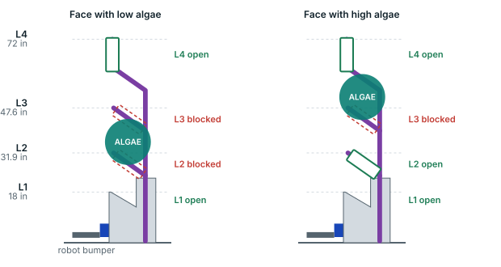

import Calc from '../../components/Calc.astro';

:::note[Draft]
First draft, written from the kickoff analysis. It uses the scoring rules as they were on kickoff day.
:::

On kickoff day you have a manual, a field drawing and a few hours. The job is to find out what scores, what gets in the way, and what the best few seconds of the match are. This is how that went for REEFSCAPE, the 2025 game.

## What we found

1. **Half the reef is locked at the start.** Algae sit on the reef and block 18 of its 36 branches. The top level, L4, is never blocked.
2. **The deep climb is the best few seconds in the match.** It is worth 12 points for about 5 seconds of work.
3. **Coral supply is not the limit.** Stations are close to the reef, so cycles are short. What limits the score is how fast the algae come off and how reliably the alliance climbs.

## The game in one minute

- **Coral** is an 11⅞ in length of 4 in PVC pipe. Each alliance scores it on its own reef: a trough (L1) and 12 pipes that each carry an L2, L3 and L4 branch. One coral per branch.
- **Algae** are 16¼ in rubber balls. Six start wedged on each reef, and three more sit on upright coral near each alliance wall. A ball on the reef blocks the branches around it.
- Algae score in your **processor** (6 points) or in the **net** over the barge (4 points). A processed ball rolls out to the other alliance's human player, who may throw it into their own net for 4.
- The match ends under the **barge**: park for 2, hang from a shallow cage for 6, or hang from a deep cage for 12.
- Coral comes from the two coral stations beside your alliance wall, plus one preload per robot and the three staged on the floor.
- A robot may hold one coral and one algae at a time, and may reach 18 in past its frame.

## Scoring

| Action | Auto | Teleop |
| --- | --- | --- |
| Leave the starting line | 3 | |
| Coral in the trough, L1 | 3 | 2 |
| Coral on L2 | 4 | 3 |
| Coral on L3 | 6 | 4 |
| **Coral on L4** | **7** | **5** |
| Algae in the processor | 6 | 6 |
| Algae in the net | 4 | 4 |
| Park in the barge zone | | 2 |
| Shallow cage | | 6 |
| **Deep cage** | | **12** |

Auto is the first 15 seconds, when the robot drives itself. Teleop is the 2 minutes 15 seconds after that.

### Ranking points

Ranking points (RP) decide where a team finishes in qualification. Six are on offer in every match.

| Ranking point | How to earn it |
| --- | --- |
| Win | 3 RP for a win, 1 for a tie |
| Auto RP | Every robot leaves the starting line, and the alliance scores at least 1 coral in auto |
| Coral RP | 5 coral on each of the four levels. Only three levels are needed if both alliances put 2 algae in their own processors, which is called Coopertition |
| Barge RP | 14 barge points. One deep climb plus one park does it |

These are the kickoff-day numbers. Later in the season the Coral RP went up to 7 coral a level and the Barge RP to 16 points. The playbook uses the kickoff numbers throughout, because that is what a team has to work with on day one.

## The algae lock the reef

A ball resting on the L2 branches blocks L2 and L3 on that face. A ball on the L3 branches blocks only L3. Neither reaches a coral on L4. Three faces start with a low ball and three with a high ball, so the match opens with all 12 L4 branches, 6 L2 branches and no L3 branches available.

That changes what the Coral RP costs:

| Route to the Coral RP | Coral needed | Algae that must come off the reef |
| --- | --- | --- |
| All four levels | 20 | 3. Each ball removed opens two L3 branches |
| **Three levels with Coopertition: L1, L2 and L4** | **15** | **None** |

The cheaper route needs 5 fewer coral and no algae removed from the reef. It does need 2 algae in the processor, and it needs the other alliance to do the same.

## The math: what is a cycle worth?

A cycle is one trip: pick up a piece, drive, score, drive back. Points per second tells you which jobs deserve the robot's time.

<Calc id="cycle-value" />

Try it for the deep climb: 12 points in a 5 second "cycle" is 2.4 points per second, about four times an L4 coral. That is why the climb made the must-have list.

## Your turn

For a new game, on kickoff day:

- [ ] Write the scoring table on one page, auto and teleop side by side.
- [ ] List every way to earn a ranking point and the cheapest way to get each one.
- [ ] Find what is blocked, limited or shared. Ask what has to happen before the best scoring spot is open.
- [ ] Measure the trips on the field drawing: where pieces come from and where they score.
- [ ] Work out points per second for each job with the calculator above.
- [ ] Circle the single best few seconds in the match.
