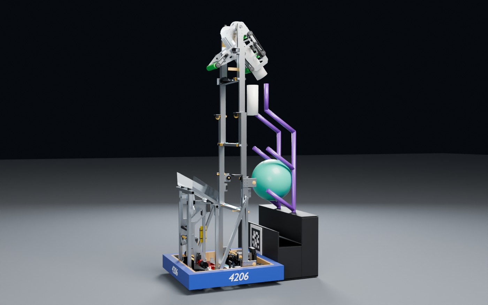
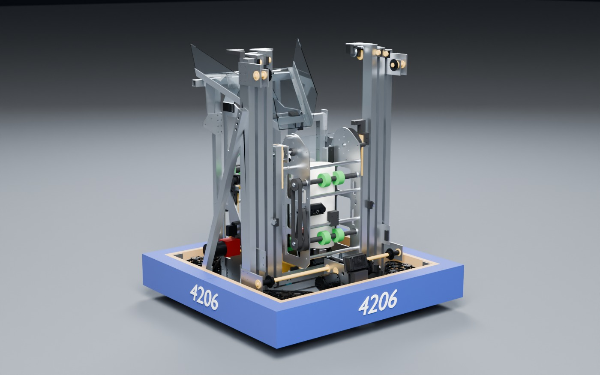
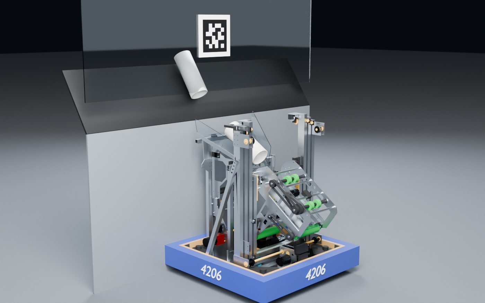
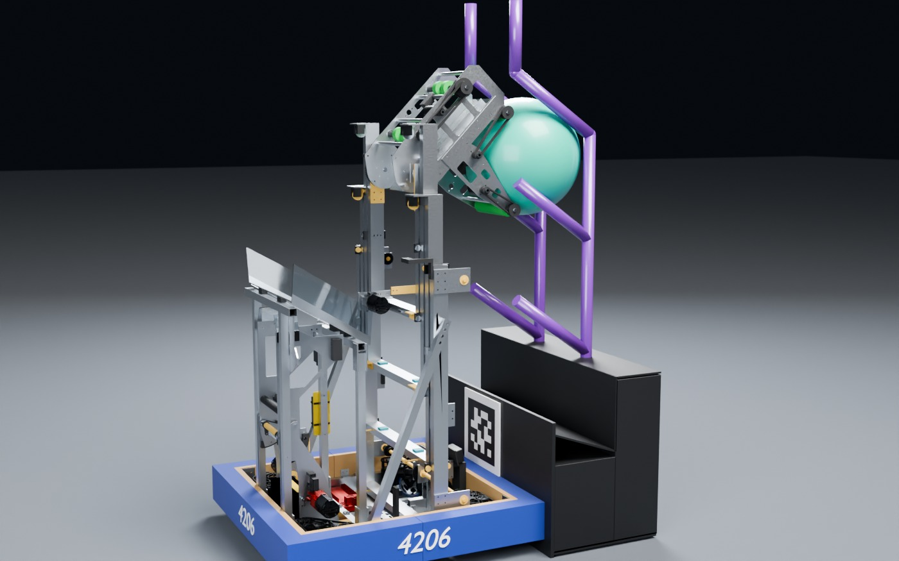
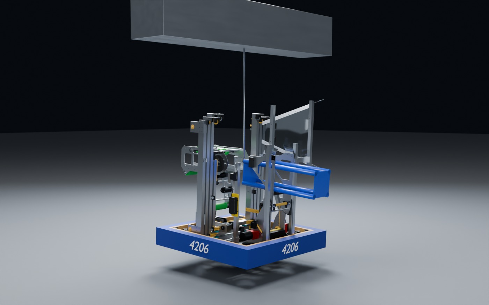

import RobotViewer from '../../../components/RobotViewer.astro';

This is the final design, taken straight from the CAD. Use it to see how the subsystems fit together before reading about each one, or to find a part and jump to the page that shows how to make it.

<RobotViewer title="The robot in 3D" />

## What you can do with it

- **Name a part.** Click or tap it. Made parts show their number and link to their page. Bought parts show what they are.
- **Find a part.** Pick it from the list and it lights up in orange, along with every copy of it.
- **Pose the robot.** The buttons move it to each scoring and climbing pose. The numbers at the top left show how tall it is and how far it reaches past the frame.
- **See one subsystem.** Untick the others, or drag the slider to pull the subsystems apart.

## The robot at work

These are ray-traced pictures of the same CAD, posed with the same numbers the robot code uses.

*Scoring on L4. The elevator is at the top of its travel and the wrist points 53° below level, straight down the line of the branch tip. An algae lower on the reef is not in the way.*

*Ready to start a match. The wrist hangs between the elevator rails with the first coral in it, the fork is up and the funnel is closed.*

*At the coral station. A coral slides down the funnel tray, between the elevator rails, toward the wrist waiting at −35°.*

*Taking the high algae. The claw's two rollers pull the ball off the reef and hold it against a backstop.*

*Climbed. The funnel has swung open, the fork has wound the cage up over the robot, and the wheels are off the carpet.*

The robot is the real model. The reef, station and cage are simple stand-ins of the right size in the right place, and the game pieces are placed by geometry. Screws, wires, chain and rope are not drawn.

## What it leaves out

- **Fasteners.** Screws, rivets and nuts are not drawn on this page. The [Assemble it](../../assemble-it/) pages draw every one, at the step where it goes in.
- **Wires, chain, the elevator ropes and the bumper cover.** These are not drawn.
- **Fine detail on bought parts.** The swerve modules, motors, electronics and camera are the makers' own CAD models, made coarser so they load quickly. Small screws and small faces are left off them. The battery is a plain box.
- **Which way round two boxes go.** The roboRIO and the main breaker fit their holes either way round, so the model cannot tell you which side their connectors face. Decide that before drilling.

The model is about 5 MB, so it can take a few seconds to appear on a slow connection.
